# Concert Ops

Concert/performance management platform with ticketing, catalog, authentication
and a full observability stack.

## What it does

- manage performers, venues and venue booking requests;
- create events and move them through `draft → scheduled → on_sale → sold_out →
  completed/cancelled`;
- sell tickets through price tiers, temporary holds and purchases;
- issue tickets and payments, refund paid orders and restore inventory;
- authenticate users with opaque session tokens and per-service introspection;
- publish `purchase.completed` to RabbitMQ and consume it in `notify`;
- expose metrics, structured logs, distributed traces and alerts;
- drive repeatable demo traffic with scenario scripts.

## Stack

| Layer | Technology |
| --- | --- |
| language / runtime | TypeScript, Node.js, Express |
| databases | PostgreSQL 17 + Drizzle ORM; SQLite for auth |
| messaging | RabbitMQ 4 + `amqplib` |
| auth | scrypt password hashing, opaque tokens, SHA-256 hashes |
| metrics | `prom-client`, Prometheus, Grafana, postgres exporters |
| logs | pino JSON logs, Alloy, Loki |
| traces | OpenTelemetry SDK, OTel Collector, Tempo |
| alerts | Prometheus rules, Alertmanager, `notify` webhook |
| runtime | Docker Compose |

## Requirements

- Docker Desktop
- Node.js >= 22 only for local development or `npm` scripts

## Getting started

### 1. Clone the repository

```bash
git clone https://github.com/valeria-chelushkina/information-systems-lab.git
cd information-systems-lab
```

### 2. Install dependencies

```bash
npm install
```

### 3. Run the demo

```bash
npm run demo
```

This is the recommended way to see the system. It starts the full Docker stack,
applies migrations, seeds the databases and runs the **mixed** scenario for
**5 minutes at 3 purchases/s**. No `.env` setup is required.

Without Node or `npm install`, use the command it wraps:

```bash
docker compose --env-file .env.example --profile demo up --build -d
```

| Where | URL |
| --- | --- |
| Grafana | `http://localhost:3007` (`admin` / `admin-password`) |
| Prometheus | `http://localhost:9090` |
| Alertmanager | `http://localhost:9093` |
| RabbitMQ | `http://localhost:15672` (`admin` / `admin`) |

Watch the simulation:

```bash
docker compose --env-file .env.example logs -f demo
```

Change duration or purchase rate:

```powershell
$env:DEMO_DURATION = "60"
$env:DEMO_RATE = "2"
npm run demo
```

```bash
DEMO_DURATION=60 DEMO_RATE=2 npm run demo
```

The demo **reseeds the databases** on every run. Stop the stack without
deleting volumes:

```bash
docker compose --env-file .env.example down
```

### Manual setup

To run the services locally instead of the demo, follow
[Development](docs/development.md). It covers `.env`, PostgreSQL and RabbitMQ,
migrations, seed scripts and the `npm run dev*` processes.

## Main commands

| Command | Purpose |
| --- | --- |
| `npm run demo` | one-command Docker demo (build, migrate, seed, mixed scenario) |
| `npm run demo:alerts` | triggers `ServiceError` and `PostgresDown`, checks Alertmanager and `notify`, then restores PostgreSQL |
| `npm run scenario -- --name=mixed --duration=300 --rate=3` | five-minute load simulation against running services |
| `npm run scenario -- --name=surge --seats=3 --buyers=10` | concurrency/inventory assertion |
| `npm run seed -- --reset --from-catalog` | 200 events from real catalog ids |
| `npm run load -- --concurrency=20` | quick concurrent purchase check |
| `npm run typecheck` | TypeScript check |
| `npm run test` | unit tests with Vitest |
| `npm run dev` | ticketing with hot reload (local development) |

`demo:alerts` intentionally stops PostgreSQL for a short controlled outage;
run it when no load test is active. It restarts PostgreSQL before exiting.

Scenario commands use local-dev ports by default (ticketing `3001`, catalog
`3003`, auth `3005`). Against Compose, add
`--ticketing-url=http://127.0.0.1:3002`, `--catalog-url=http://127.0.0.1:3004`
and set `AUTH_BASE_URL=http://127.0.0.1:3006`.

More commands: [development](docs/development.md). More scenarios:
[scenarios](docs/scenarios.md).

## Observability

Grafana contains eight provisioned dashboards: Overview, API Monitoring,
Service Detail, Postgres, Messaging, Business, Logs and Traces. The stack
exposes metrics, logs and traces out of the box. Alerts can also be emailed by
configuring `SMTP_*` and `ALERT_EMAIL_TO` for `notify`.

| Where | What |
| --- | --- |
| `http://localhost:3007` | Grafana: dashboards, Explore for Loki and Tempo |
| `http://localhost:9090` | Prometheus: targets, PromQL, alert rules |
| `http://localhost:9093` | Alertmanager: firing alerts and silences |
| `http://localhost:15672` | RabbitMQ management |
| `http://localhost:3100` | Loki (queried through Grafana) |
| `http://localhost:3200` | Tempo HTTP API (queried through Grafana) |

Start with the [observability guides](docs/observability/README.md), or the
per-service documents: [Prometheus](docs/observability/prometheus.md),
[Grafana](docs/observability/grafana.md),
[Loki](docs/observability/loki.md), [Alloy](docs/observability/alloy.md),
[Tempo](docs/observability/tempo.md),
[OTel Collector](docs/observability/otel-collector.md),
[postgres_exporter](docs/observability/postgres-exporter.md),
[Alertmanager](docs/observability/alertmanager.md),
[RabbitMQ](docs/observability/rabbitmq.md) and
[notify](docs/observability/notify.md).

## Documentation

| Document | Content |
| --- | --- |
| [Architecture](docs/architecture.md) | services, data ownership, flows, deployment, design decisions |
| [Database schema](docs/database.md) | Mermaid ER diagrams for ticketing, catalog and auth |
| [API reference](docs/api/README.md) | auth, conventions and per-service endpoints |
| [Scenarios](docs/scenarios.md) | browse, purchase, surge, chaos, refund, mixed |
| [Development](docs/development.md) | local setup, migrations, seeds, all commands |
| [Observability](docs/observability/README.md) | per-service guides and quick health checks |
## Screenshots

Captured from the Docker demo with the Last 15 minutes time range.

### Concert Ops Overview

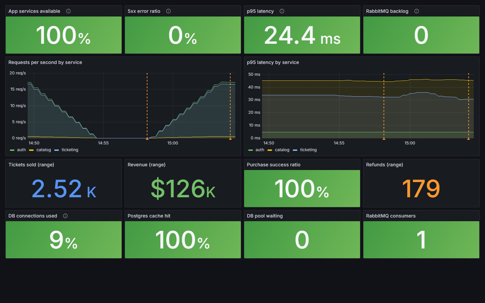

### API Monitoring

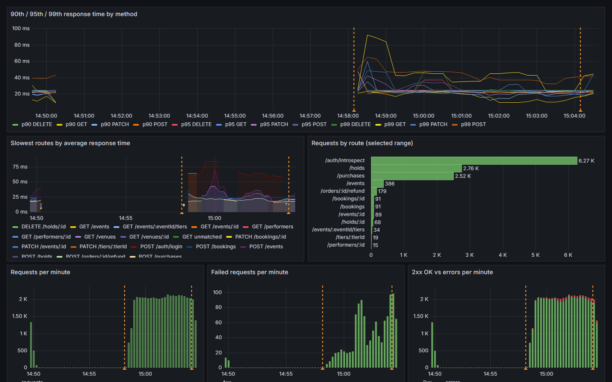

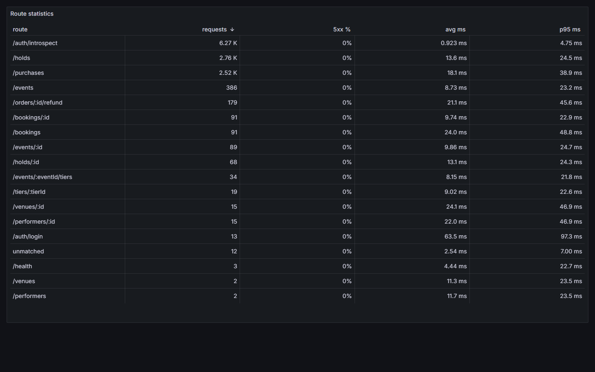

### Service Detail

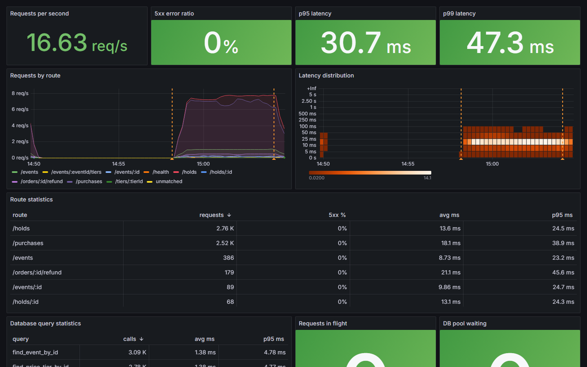

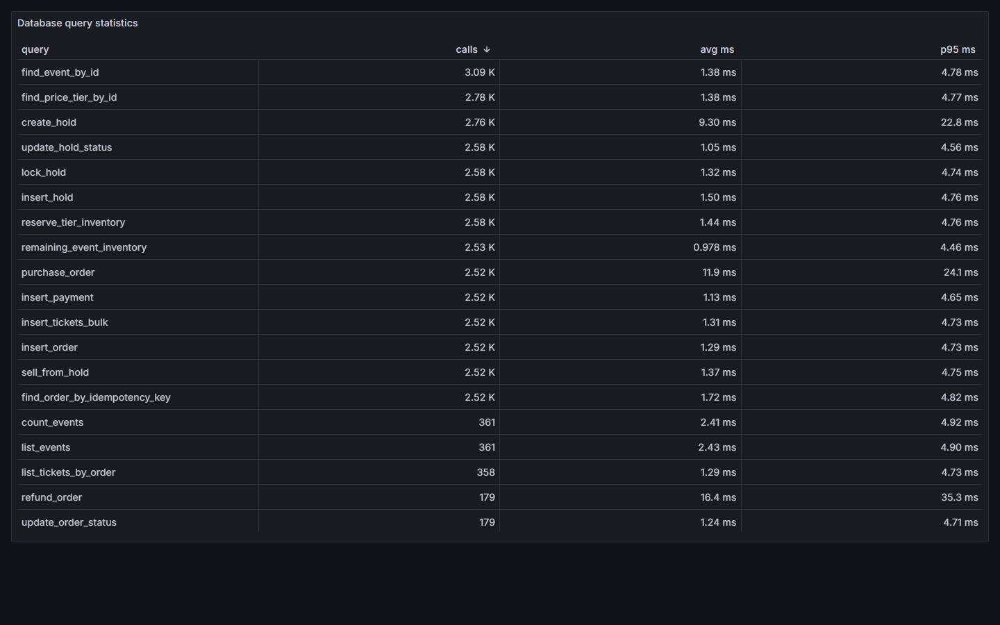

### Postgres

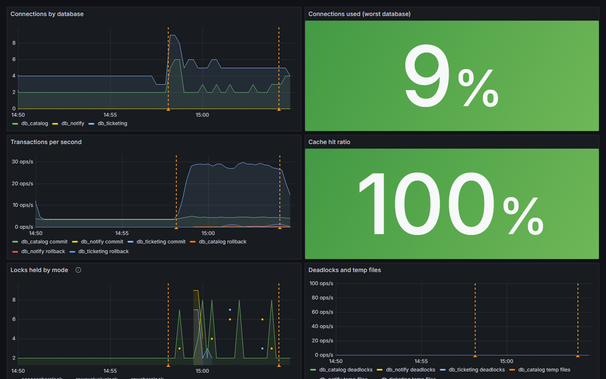

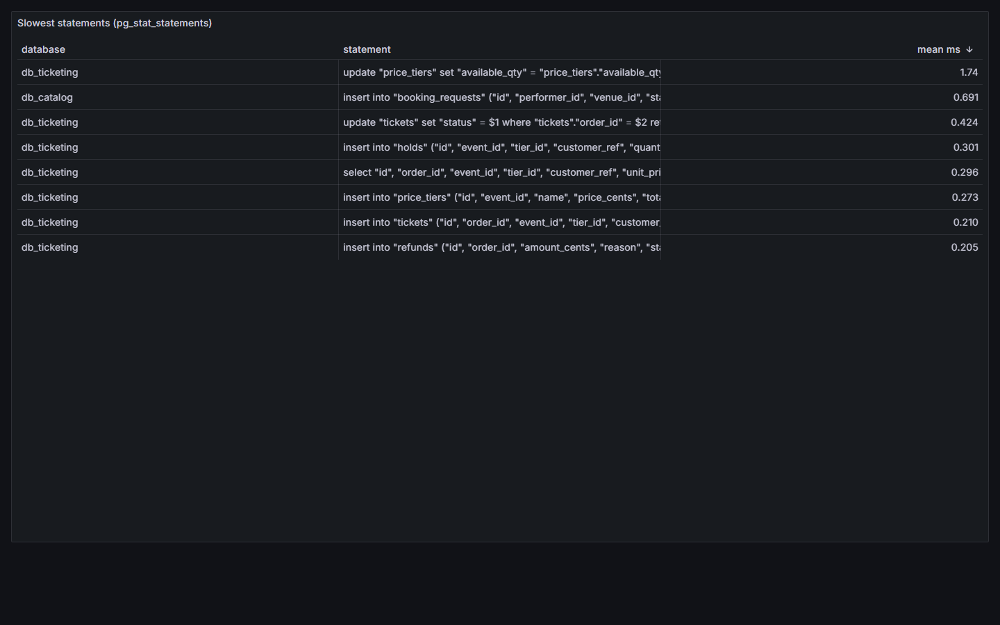

### Messaging

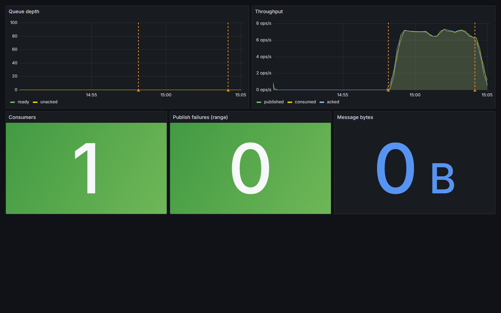

### Business

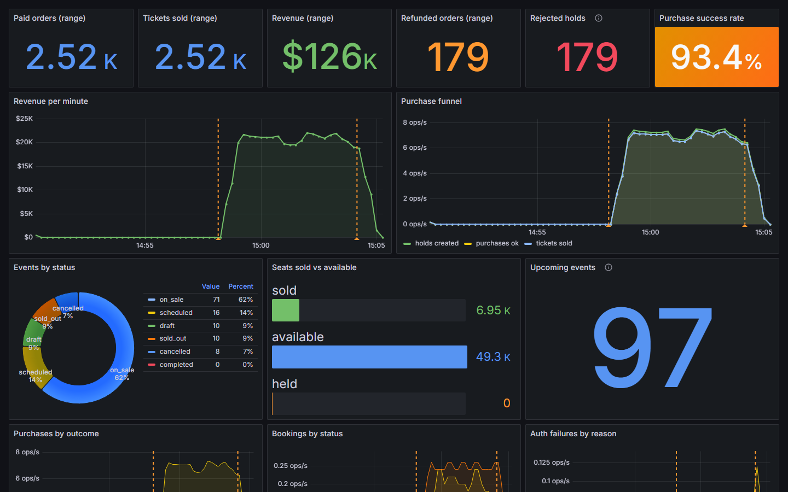

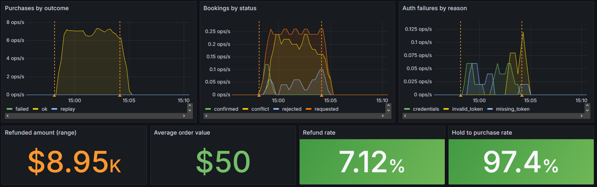

### Logs

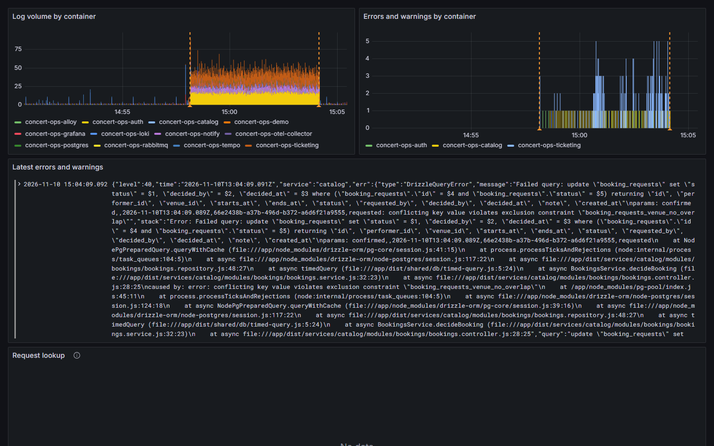

### Traces

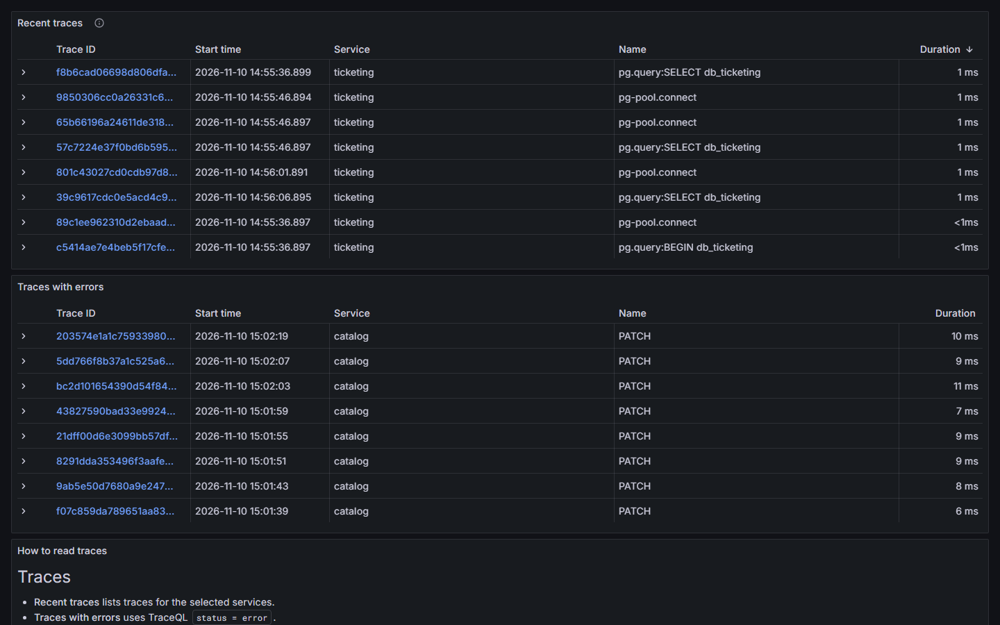
