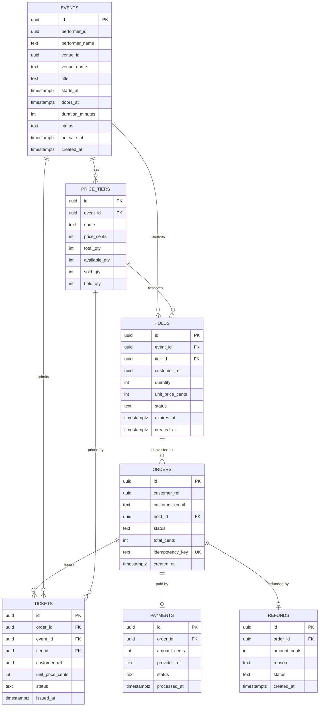
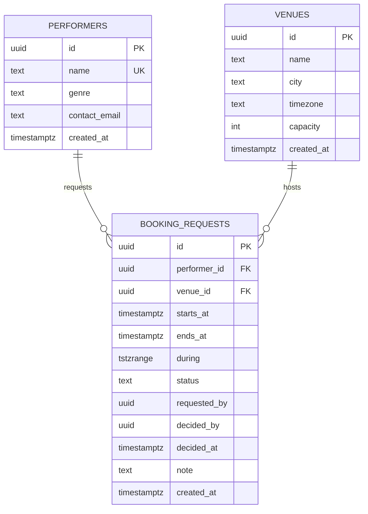
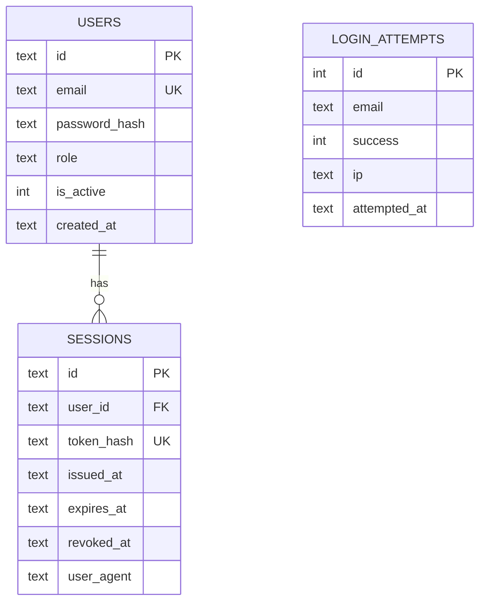

# Database schema

The system has three databases with separate ownership:

| Database | Engine | Owner | Tables |
| --- | --- | --- | --- |
| `db_ticketing` | PostgreSQL 17 | `ticketing` | events, price tiers, holds, orders, tickets, payments, refunds |
| `db_catalog` | PostgreSQL 17 | `catalog` | performers, venues, booking requests |
| `auth.db` | SQLite | `auth` | users, sessions, login attempts |

There are no foreign keys between databases. References across services are
ids plus snapshotted display names. Money is always integer cents.

## Ticketing



### Rules encoded in the schema

| Rule | Where |
| --- | --- |
| `available_qty + sold_qty + held_qty = total_qty` | `price_tiers_qty_consistent` check |
| no negative quantities or prices | per-column checks |
| event statuses: `draft`, `scheduled`, `on_sale`, `sold_out`, `completed`, `cancelled` | `events_status_check` |
| hold statuses: `active`, `converted`, `expired`, `cancelled` | `holds_status_check` |
| order statuses: `pending`, `paid`, `failed`, `cancelled`, `refunded` | `orders_status_check` |
| ticket statuses: `issued`, `checked_in`, `refunded`, `void` | `tickets_status_check` |
| payment statuses: `authorized`, `captured`, `failed`, `refunded` | `payments_status_check` |
| refund statuses: `pending`, `completed`, `failed` | `refunds_status_check` |
| doors before start, positive duration | `events_doors_before_start_check`, `events_duration_check` |
| one payment per order | unique `payments_order_id_key` |
| one refund per order | unique `refunds_order_id_key` |
| purchase replay protection | unique `orders_idempotency_key_key` |
| one tier name per event | unique `price_tiers_event_name_key` |
| fast hold expiry sweeps | partial index `holds_active_expiry_idx` on `expires_at` where status is `active` |

Deleting an event cascades to its price tiers and holds; deleting an order
cascades to tickets, payment and refund rows. Those cascades exist only inside
`db_ticketing`.

### Inventory transitions

```
hold created        available -= n, held += n
hold cancelled      available += n, held -= n
hold expired        available += n, held -= n
purchase            held -= n, sold += n
refund              sold -= n, available += n
```

Reservation and sale are single conditional updates, so inventory cannot go
negative under concurrent buyers.

## Catalog



### Rules encoded in the schema

| Rule | Where |
| --- | --- |
| performer names are unique | unique `performers_name_key` |
| a venue name is unique within a city | unique `venues_name_city_key` |
| capacity is positive | `venues_capacity_check` |
| booking statuses: `requested`, `confirmed`, `rejected`, `cancelled` | `booking_requests_status_check` |
| end is later than start | `booking_requests_period_check` |

`during` is a generated column: `tstzrange(starts_at, ends_at, '[)')`. The
actual overlap protection is a hand-written migration, because Drizzle cannot
express it:

```sql
EXCLUDE USING gist (venue_id WITH =, during WITH &&)
WHERE (status = 'confirmed')
```

Two confirmed bookings for the same venue can never overlap. The constraint
applies only to confirmed rows, so multiple requests can be pending for the
same period.

## Auth (SQLite)



### Notes

- `users.role` is one of `customer`, `staff`, `admin`.
- `users.password_hash` stores a scrypt hash.
- `sessions.token_hash` stores a SHA-256 hash; the raw token is returned once.
- `sessions` cascades on user deletion.
- `login_attempts` has no foreign key: it is an audit table keyed by the
  attempted email, so it still records failed logins for unknown accounts.
- indexes: `sessions_token_hash_idx`, `login_attempts_email_idx`.

The SQLite schema is created at startup and by the auth seed script; there is
no SQL migration folder for auth.

## Cross-database rules

| Rule | Reason |
| --- | --- |
| no foreign keys between `db_ticketing` and `db_catalog` | services own their data |
| performer and venue names snapshot into `events` | catalog renames must not rewrite history |
| each service has its own database role | least privilege; separate backup/restore |
| money is integer cents | no floating-point rounding |
| timestamps are timezone-aware in PostgreSQL | consistent event and hold expiry |
| statuses are text plus `CHECK` constraints | explicit state machines without enum migrations |

Migrations live in `drizzle/ticketing/` and `drizzle/catalog/`. Apply them with
`npm run db:migrate` and `npm run db:migrate:catalog`.
