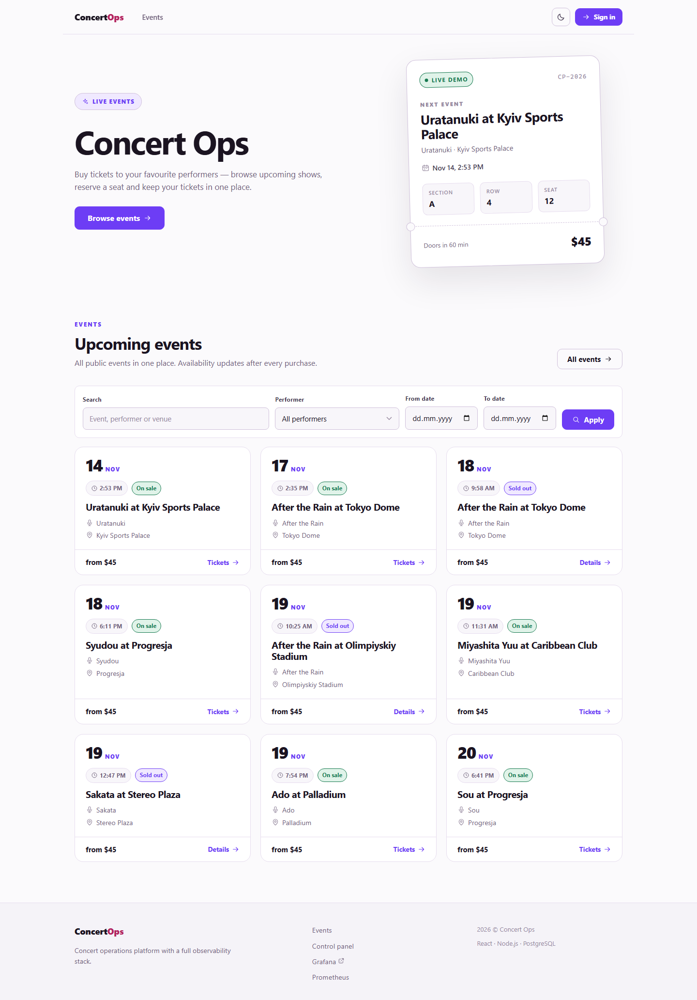
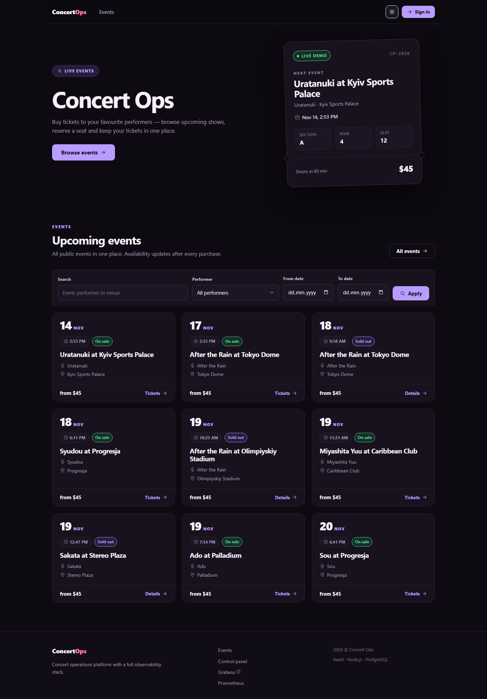
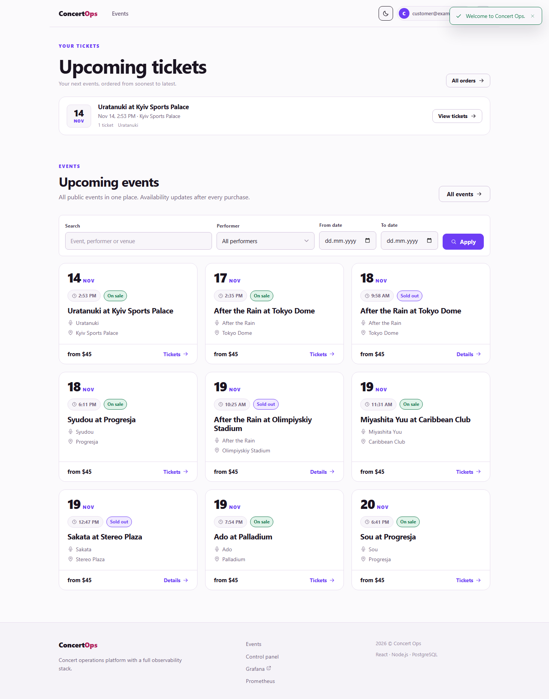
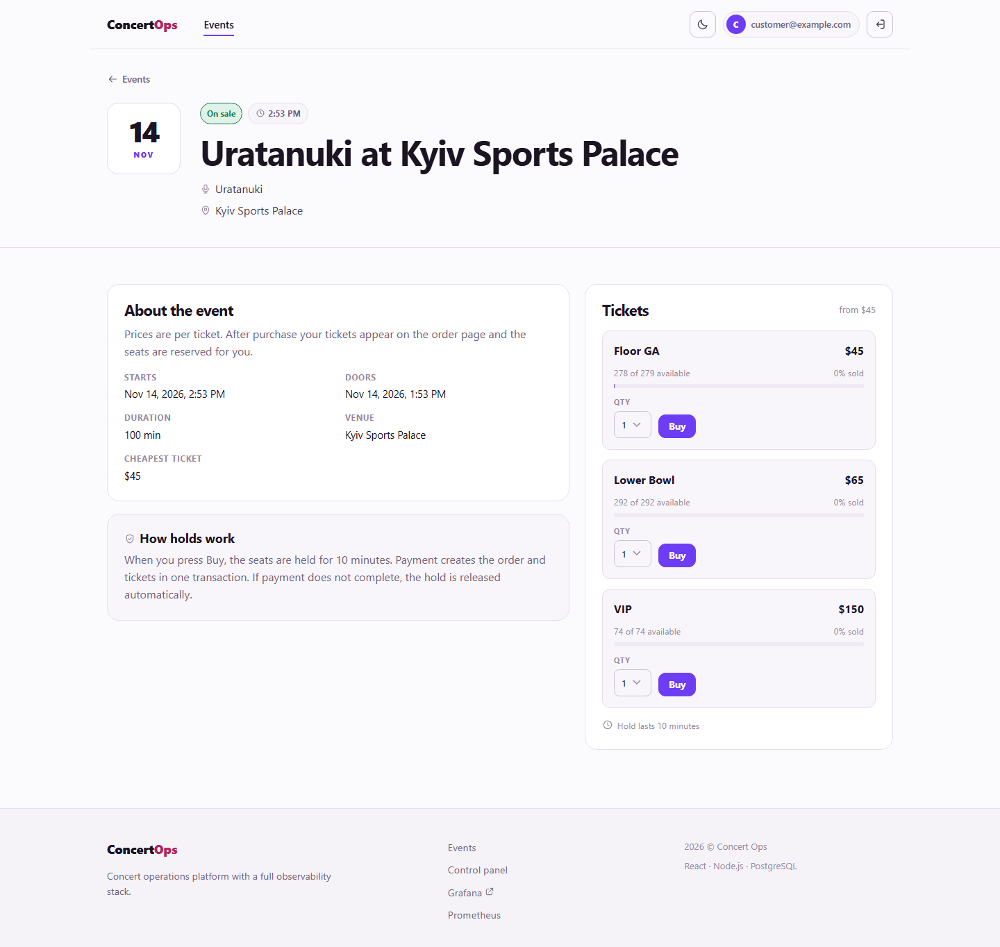
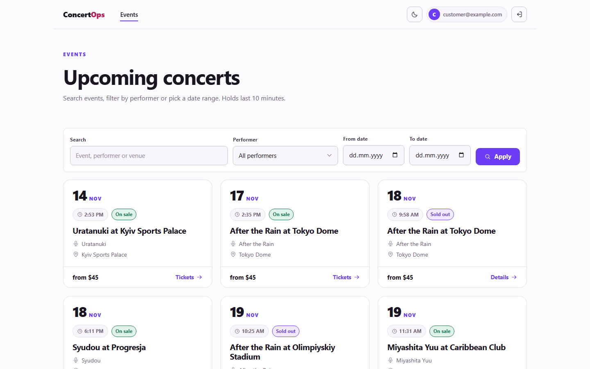
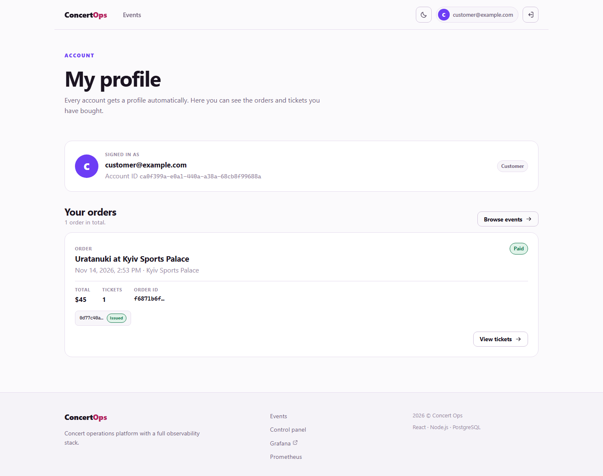
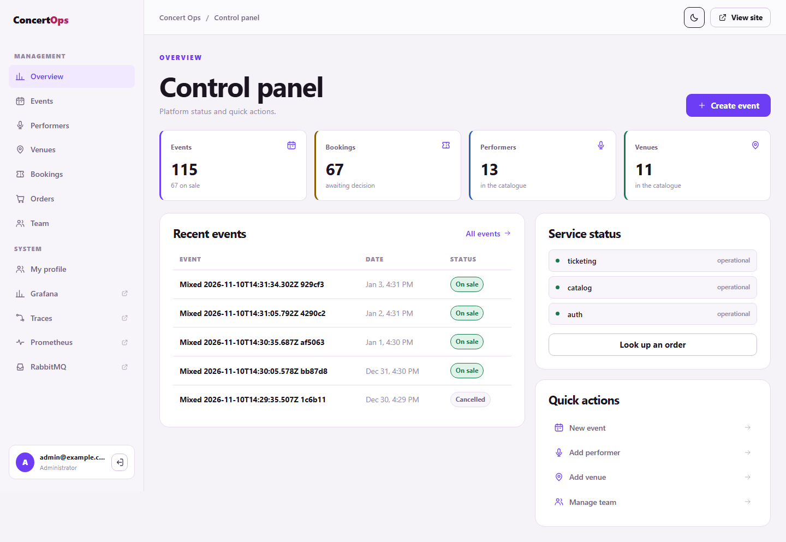
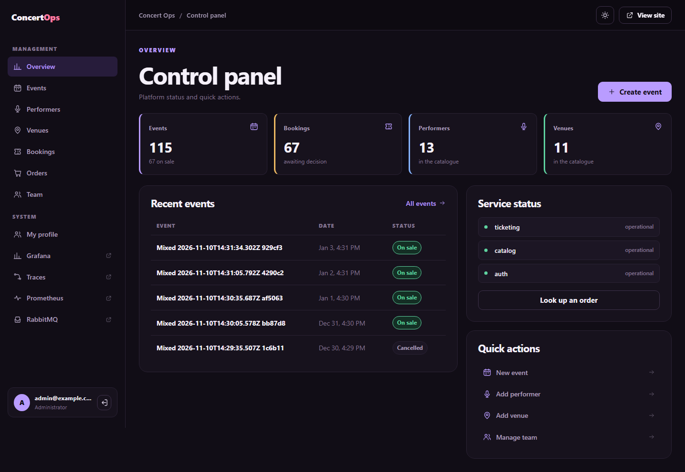
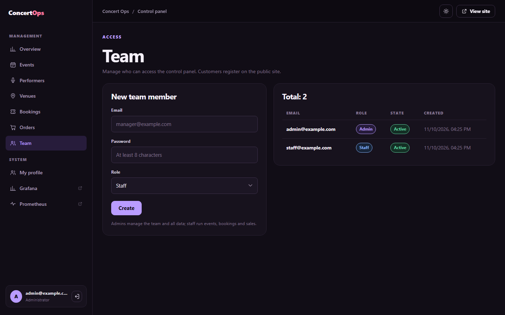

# Web UI

The web client is a React 19 single-page application served by the `web`
service. The interface is in English. The same service also acts as a
backend-for-frontend (BFF): it keeps the opaque session token in an httpOnly
cookie and calls ticketing, catalog and auth over the internal Docker network.

## Stack

| Layer | Choice |
| --- | --- |
| UI | React 19, React Router 7, TypeScript |
| build | Vite 7, `dist/web` output |
| BFF | Express 4, `fetch`, zod validation |
| styling | hand-written CSS, light and dark themes, no gradients |
| auth | httpOnly cookie, server-side introspection |
| runtime | Node.js 24, Docker Compose |

## Structure

```
ui/src/
  App.tsx                  routes
  main.tsx                 entry point
  styles.css               design system and page styles
  components/              layout, guards, cards, badges, icons
  constants/               links, navigation, filters, page sizes, status tones
  context/                 auth, theme and toast providers
  helpers/                 API client, formatting, user helpers
  hooks/                   useApi, useAuth, useTheme, useToast
  typedefs/                shared domain, API and component types
  pages/                   public screens
  pages/admin/             admin screens
src/services/web/
  api/                     BFF routes, controllers and schemas
  clients/                 auth, ticketing and catalog HTTP clients
  modules/session/         cookie session and role guards
  modules/pages/           public and account service logic
  modules/admin/           admin service logic
  lib/time.ts              Kyiv local time to UTC
```

## Screens

Public:

| Route | Screen |
| --- | --- |
| `/` | landing: personal tickets for signed-in users, intro for guests, then upcoming events |
| `/events` | paginated event catalogue with search, performer and date filters |
| `/events/:id` | event details, tiers and purchase |
| `/login` | sign-in and self-service registration (customer role) |
| `/profile` | customer profile with account details, orders and tickets |
| `/orders/:id` | order and tickets, refund |

Admin (staff and admin):

| Route | Screen |
| --- | --- |
| `/admin` | dashboard: counts, service health, recent events |
| `/admin/events` | paginated event list with search, performer, date and status filters |
| `/admin/events/new` | create event |
| `/admin/events/:id` | event details, status transitions, tiers |
| `/admin/performers` | performer directory, paginated |
| `/admin/venues` | venue directory, paginated |
| `/admin/bookings` | paginated booking requests, confirm or reject |
| `/admin/orders` | order lookup and refund |
| `/admin/users` | Team: staff and admin accounts, creation (admin only) |

## Authentication flow

```
browser ──POST /api/session──▶ web ──POST /auth/login──▶ auth
   ▲                             │
   └── httpOnly concert_session ─┘

browser ──POST /api/register──▶ web ──POST /auth/register──▶ auth
   ▲                             │  role is always customer
   └── httpOnly concert_session ─┘

browser ──GET /api/admin/...──▶ web ──Bearer token──▶ ticketing / catalog
                                       └──POST /auth/introspect
```

The browser never receives the raw token. `web` reads the cookie, calls
`/auth/me`, and attaches the bearer token to upstream requests. Logout revokes
the session in auth and clears the cookie.

Registration is public: the login screen has a Create account tab. New accounts
are always created with the `customer` role, and the BFF signs the user in
immediately after registration.

Every account has a profile at `/profile`; no separate profile record is
created. The page shows the account identity plus the customer's orders and
tickets, with links to the full order page.

The public ticketing route `GET /api/orders` filters by the authenticated
`user_id`, so one customer cannot read another customer's orders.

Role rules:

| Role | Access |
| --- | --- |
| `customer` | catalogue, purchase, own orders and profile |
| `staff` | admin panel without team management |
| `admin` | everything, including team management |

The Team page lists only `admin` and `staff` accounts. Customers register on the
public site and never appear in the access-management list.

## Observability shortcuts

The admin sidebar links directly to the observability stack:

| Link | Target |
| --- | --- |
| Grafana | `http://localhost:3007` |
| Traces | Grafana `Traces` dashboard, last hour |
| Prometheus | `http://localhost:9090` |
| RabbitMQ | management UI, `http://localhost:15672` |

These links make sense for operators: traces show request waterfalls and errors,
while RabbitMQ management exposes queue depth, consumers and publish/deliver
rates. The same links are available from the public footer where relevant.

## Security

- session cookie is `HttpOnly`, `SameSite=Lax`, `Path=/`, optional `Secure`;
- every mutating request is checked against the `Origin` header;
- mutating requests with a body must use `application/json`;
- responses set CSP, `X-Frame-Options: DENY`, `X-Content-Type-Options` and
  `Referrer-Policy`;
- validation failures and upstream errors are normalised by the BFF;
- React never renders raw HTML from API data;
- public registration always creates a `customer`; production deployments should
  add rate limiting and email verification.

## Development

Run the backend services, the BFF and the Vite dev server:

```bash
npm run dev
npm run dev:catalog
npm run dev:auth
npm run dev:web
npm run dev:ui
```

Vite serves `http://localhost:5173` and proxies `/api` to
`http://127.0.0.1:3009`. The BFF alone runs on `:3009`.

Build and run the production bundle:

```bash
npm run build
npm run start:web
```

`npm run build` compiles the server and emits the SPA into `dist/web`. In
Docker the `web` service serves that directory and exposes port `3008`.

## Configuration

| Variable | Default | Purpose |
| --- | --- | --- |
| `WEB_PORT` | `3009` | BFF port |
| `WEB_HOST_PORT` | `3008` | published Docker port |
| `AUTH_BASE_URL` | `http://127.0.0.1:3005` | auth service |
| `TICKETING_BASE_URL` | `http://127.0.0.1:3001` | ticketing service |
| `CATALOG_BASE_URL` | `http://127.0.0.1:3003` | catalog service |
| `WEB_COOKIE_SECURE` | `false` | require HTTPS cookies |
| `WEB_TIME_ZONE` | `Europe/Kyiv` | display time zone |

## Seeded accounts

| Email | Password | Role |
| --- | --- | --- |
| `admin@example.com` | `admin-password` | admin |
| `staff@example.com` | `staff-password` | staff |
| `customer@example.com` | `customer-password` | customer |

## Themes

The interface supports light and dark themes with a single set of CSS tokens.
The toggle in the site header and the admin top bar is available on every
screen. The choice is stored in `localStorage`; the first visit follows the
operating system preference, and `ui/public/theme.js` applies it before the
first paint.

The palette is flat and gradient-free:

| Token | Light | Dark |
| --- | --- | --- |
| background | near-white `#fbfafc` | plum-black `#0d0a11` |
| surface | white `#ffffff` | `#17121d` |
| text | ink `#1b1421` | `#f5f0fa` |
| accent | purple `#6d3df5` | lilac `#b99cff` |
| secondary accent | raspberry `#b3245f` | pink `#ff7aa2` |

All surfaces use solid fills, 1px borders and a limited set of soft status
tints. Progress bars, buttons, badges, the ticket card and the landing sections
contain no gradients.

## Screenshots

Landing page, light theme:



Landing page, dark theme:



Landing page for a signed-in customer with upcoming tickets:



Event page with tiers and purchase:



Events page with search, performer and date filters:



Customer profile with purchased tickets:



Admin dashboard, light theme:



Admin dashboard, dark theme:



Team page with staff and admin accounts only:



## Related

- [BFF API](api/web.md)
- [Architecture](architecture.md)
- [Development](development.md)
